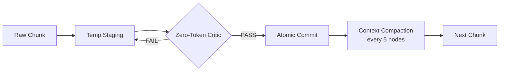

# SPINE: Hierarchical Graph Memory for Long-Horizon AI Agents

> Read this in: [English](README.md) · [Русский](README_RU.md)


**SPINE** is a lightweight Markdown- and YAML-based cognitive memory framework
that gives LLM agents persistent, scalable, low-latency long-term memory without
heavy vector-database overhead.

Battle-tested on a real-world personal knowledge graph of **532 structured memory
nodes (~2.6M+ chars indexed)** and **460+ typed semantic links**, with schema
integrity enforced by deterministic, zero-token CI checks.

---

## The Problem

Standard flat RAG degrades as a knowledge base grows past a few hundred documents:

- **Context bloat & token cost** — full raw chunks exhaust context windows with
  logs, formatting noise, and boilerplate.
- **Loss of causality & chronology** — vector similarity misses temporal order
  (`roots -> after`) and high-level thematic grouping.
- **Destructive compression** — summarization discards original data, blocking
  forensic lookups and future fine-tuning.
- **Memory rot & hallucination** — without periodic consolidation and schema
  validation, agent memory accumulates noise.

---

## Core Architecture

SPINE organizes memory into a **3-tier cognitive topology** modeled after
biological neural organization:

```
[ Tier 1: Domains — macro-areas ]
              │
              ▼
[ Tier 2: Constellations — thematic clusters, 5–20 nodes ]
              │
              ▼
[ Tier 3: SPINE Nodes — atomic memory units, ~5k chars each ]
```

### Key mechanisms

1. **Deterministic ingestion & chunking.** Raw logs are pre-processed by
   deterministic Python scripts into ~5,000-char Markdown chunks *before* touching
   an LLM — cutting ingestion token cost and semantic load.
2. **Multi-layer progressive disclosure** (`Constellation` → `Impulse` →
   `Summary` → `Cleaned` → `Raw`). The agent walks a relevance funnel instead of
   loading raw chunks upfront:
   - **Routing & scent** — filter by domain/constellation, scan 1–2-line
     **impulses** and **anchors** inside candidate clusters.
   - **Synthesis** — read the 3–5-sentence **summary** to confirm relevance.
   - **Precision context** — load artifact-free **cleaned data**.
   - **Lossless basement** — preserve the untouched original in **source_base**
     (≥70% byte ratio) for forensic drill-down and future LoRA/QLoRA fine-tuning.
3. **Multi-dimensional navigation & Hebbian salience.**
   - Chronological chains: `roots` → `after` with typed relations
     (`:continuation`, `:genesis`, `:contrast`, …).
   - Typed `semantic_links` + a compiled `reverse_index.json` for bidirectional
     traversal without mutating existing YAML.
   - `strategic_weight` (0.0–1.0), `access_count`, `last_accessed` keep active
     memories hot while dormant ones cool without dead links.
4. **Zero-token deterministic guardrails.** `_critic_check.sh` and
   `_quality_audit.py` enforce structure, length caps (`IMPULSE <= 2 lines`,
   `SUMMARY <= 5 sentences`), anchor canon compliance, and `SOURCE_BASE >= 70%`
   byte retention via instant bash/Python checks — no LLM-vs-LLM critic loops.
5. **Hybrid compute routing.** Designed for constrained edge hardware: local
   embeddings on a Linux GPU, lightweight API models for routine extraction,
   frontier models reserved strictly for deep synthesis.

---

## Graph scale & metrics

| Metric | Value |
| :--- | :--- |
| Production graph scale | 532 nodes (~2.6M+ chars indexed) |
| Typed semantic links | 460+ edges |
| Embedding links | 1496 (top-5, threshold 0.88) |
| YAML validity — production | 97% (518/532), enforced by `critic_check` |
| YAML validity — demo corpus | 100% (3/3 PASS) |
| Chunk granularity | ~5,000 chars |
| Retrieval strategy | progressive disclosure |

---

## Batch Ingestion & Staging Workflow



The agent writes each node draft into a temporary buffer (`TEMP`), runs
`_critic_check.sh` on it, resolves boundary cases on its own with bounded
discretion (e.g. a short source chunk, or a decimal point miscounted as a
sentence terminator) without looping in self-criticism, and only then atomically
commits the valid node into the production graph. Every 5 nodes the heavy
context is compacted into lightweight snapshots.

This staging discipline enables ingesting **40+ raw nodes in a row (500k+
tokens)** in a single session without degradation, at a marginal cost of
**~$0.01/node** (deterministic validation is token-free; only the final write
consumes model tokens).

---

## Repository structure

```
.
├── methodology/
│   ├── SPINE_METHODOLOGY.md      # format spec (RU)
│   └── SPINE_METHODOLOGY_EN.md   # format spec (EN)
├── raw/
│   ├── U001.md                # raw chunk #1
│   ├── U002.md                # raw chunk #2
│   └── U003.md                # raw chunk #3
├── nodes/
│   ├── KEDR_001.md            # processed node (domain «Связь»)
│   ├── KEDR_002.md            # processed node (domain «Карта»)
│   └── KEDR_003.md            # processed node (domain «Тайны_Груза»)
├── anchors/
│   └── anchor_dump.json       # anchor canon for the demo graph
└── tools/                     # validation & traversal utilities
    ├── _critic_check.sh
    ├── _check_anchors.py
    ├── _crosslink.py
    ├── _wander.py
    ├── _quality_audit.py
    ├── mcp_server.py          # MCP server (FastMCP)
    └── benchmark_tokens.py    # token savings benchmark
```

The demo corpus (`KEDR_001..003`) is written in **Russian** to verify Cyrillic
tokenization and semantic anchors. All tools and the schema are
language-agnostic.

---

## Quickstart

All commands run from the repository root.

```bash
# 1. Auto-audit nodes (clean PASS expected)
bash tools/_critic_check.sh nodes raw anchors/anchor_dump.json

# 2. Validate anchors against the canon
python tools/_check_anchors.py nodes/KEDR_001.md --dump anchors/anchor_dump.json --quiet

# 3. Walk the graph (forward and backlinks)
python tools/_wander.py --from KEDR_001 --hops 2 --folder nodes

# 4. Global quality audit
python tools/_quality_audit.py --nodes nodes --raw raw

# 5. Crosslink generation (dry run / apply)
python tools/_crosslink.py --folder nodes
python tools/_crosslink.py --folder nodes --apply

# 6. MCP server (stdio, for Claude Desktop / Cursor / Windsurf)
pip install -r requirements.txt
python tools/mcp_server.py

# 7. Token savings benchmark
python tools/benchmark_tokens.py
```

---

## Node format (v2.1)

```
---                          # YAML frontmatter
id: KEDR_001
type: spine_node
domain: Связь
hub: "[[Кедр_Связь]]"
constellation: Кедр-9 Expedition
vectors:
  - "связь::трёхслойный_архив"  # comment required
search_anchors:
  - трёхслойный_архив
chronology:
  roots: "[[U001]]"
  after: "[[KEDR_002]]:continuation"
semantic_links:
  - "[[KEDR_002]]::продолжение"
---

# IMPULSE        — 1–2 lines
# SUMMARY        — 3–5 sentences
# CLEANED_DATA   — ~25 lines of facts
# IMPACT         — strategic_weight + key_insight
# SOURCE_BASE    — ≥70% of the raw source
---
```

Full specification: `methodology/SPINE_METHODOLOGY_EN.md` (RU: `methodology/SPINE_METHODOLOGY.md`).
