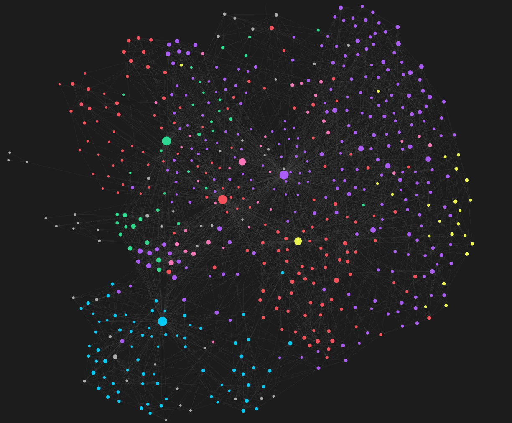
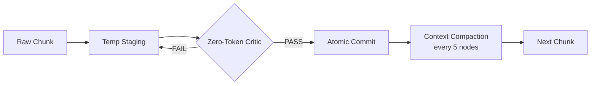

# SPINE: Иерархическая графовая память для агентов с длинным горизонтом

> Читать на: [Русский](README_RU.md) · [English](README.md)


**SPINE** — лёгкий фреймворк когнитивной памяти на Markdown и YAML, дающий
LLM-агентам устойчивую, масштабируемую и низколатентную долговременную память
без тяжёлой векторной инфраструктуры.

Обкатан на реальном графе знаний из **532 структурированных узлов (~2.6M+
символов проиндексировано)** и **460+ типизированных семантических связей**;
целостность схемы контролируется детерминированными CI-проверками без трат
токенов.

> Твоя IDE помнит **ЧТО** лежит в файле. SPINE помнит **ПОЧЕМУ** оно там — с чеками.

---

## SPINE за 60 секунд

**Dev / IDE.** Кодинг-агент видит `sleep(200)` в retry-цикле и тянется «починить».
Он делает `git blame`, находит коммит и спрашивает SPINE. SPINE возвращает
post-mortem-узел: *«инцидент 2026-03: API отдаёт 429, если ретраить быстрее
200 мс»*. Агент оставляет строку в покое. Никакого 3-часового пейджа.

**Long-horizon-агент.** Агент, работающий 500+ сессий месяцами, с 2.6M+
символов контекста, вспоминает решение трёхмесячной давности. Он идёт по
воронке — `impulse` (2 строки) → `summary` (5 предложений) → `cleaned_data` →
`source_base` — тратя ~60 токенов на первый шаг вместо загрузки всего корпуса.
Себестоимость: **~$0.01/узел**.

---

## Проблема

Плоский RAG деградирует, когда база знаний переваливает за несколько сотен
документов:

- **Раздувание контекста и стоимость токенов** — полные сырые чанки выжигают
  окно контекста логами, форматированием и шумом.
- **Потеря причинности и хронологии** — векторное сходство не видит временной
  порядок (`roots -> after`) и тематическую группировку верхнего уровня.
- **Разрушительное сжатие** — суммаризация отбрасывает исходные данные,
  блокируя глубокий разбор и будущий файнтюнинг.
- **Деградация памяти и галлюцинации** — без периодической консолидации и
  валидации схемы память агента копит шум.

---

## Архитектура ядра

SPINE организует память в **3-уровневую когнитивную топологию**, построенную
по образцу нейронной организации:

```
[ Уровень 1: Домены — макрообласти ]
              │
              ▼
[ Уровень 2: Созвездия — тематические кластеры, 5–20 узлов ]
              │
              ▼
[ Уровень 3: SPINE-узлы — атомарные единицы памяти, ~5k символов ]
```

### Ключевые механизмы

1. **Детерминированная обработка и сегментация.** Сырые логи режутся
   детерминированными Python-скриптами на чанки ~5 000 символов *до* обращения
   к LLM — это срезает токен-стоимость ввода и семантическую нагрузку.
2. **Многослойное прогрессивное раскрытие** (`Созвездие` → `Импульс` →
   `Сводка` → `Очищенные данные` → `Сырой подвал`). Агент проходит воронку
   релевантности вместо загрузки сырых чанков напролом:
   - **Маршрутизация и «запах»** — фильтр по домену/созвездию, скан 1–2-строчных
     **импульсов** и **якорей** внутри кандидатных кластеров.
   - **Синтез** — чтение **сводки** (3–5 предложений) для подтверждения.
   - **Точный контекст** — загрузка **очищенных данных** без артефактов.
   - **Несжимаемый подвал** — нетронутый оригинал в **source_base** (≥70% по
     байтам) для глубокого разбора и будущего LoRA/QLoRA-файнтюнинга.
3. **Многомерная навигация и Hebbian-значимость.**
   - Хронологические цепочки: `roots` → `after` с типизированными связями
     (`:continuation`, `:genesis`, `:contrast`, …).
   - Типизированные `semantic_links` + компилируемый `reverse_index.json` для
     двунаправленного обхода без изменения существующего YAML.
   - `strategic_weight` (0.0–1.0), `access_count`, `last_accessed` держат
     активные воспоминания «горячими», а спящие остывают без мёртвых ссылок.
4. **Zero-token детерминированные предохранители.** `_critic_check.sh` и
   `_quality_audit.py` проверяют структуру, лимиты длин (`IMPULSE <= 2 строк`,
   `SUMMARY <= 5 предложений`), соответствие канону якорей и сохранность
   `SOURCE_BASE >= 70%` байт мгновенными bash/Python-проверками — без циклов
   «LLM-критик против LLM».
5. **Гибридная маршрутизация вычислений.** Рассчитано на ограниченное
   edge-железо: локальные эмбеддинги на Linux GPU, лёгкие API-модели для
   рутинной экстракции, frontier-модели — строго для глубокого синтеза.

---

## Dev-надстройка: память *вокруг* кода

SPINE — не индекс символов: это уже умеют LSP, Tree-sitter и `ripgrep`.
SPINE хранит **намерение**: почему принято решение, что ломалось, где грабли.
Один тип узла, четыре вида, привязка к коду указателем на Git (а не копией
исходников):

```yaml
kind: adr | postmortem | gotcha | contract
repo_ref: {path, commit, lines}
code_refs: ["src/auth/jwt.py::verify_token@a1b2c3d"]
status: active | superseded | historical   # факты не «протухают», их вытесняют
```

Dev-инструменты:

- `spine_for_file(filepath)` — ADR / post-mortem / gotcha по файлу кода
- `spine_preflight --files ...` — что ты можешь сломать *до* того, как сломал
- `_git_hook.py --kind ...` — каркас узла из смерженного PR
  (память наполняется сама, как побочный эффект работы)

---

## Масштаб графа и метрики

| Метрика | Значение |
| :--- | :--- |
| Масштаб боевого графа | 532 узла (~2.6M+ символов) |
| Типизированные семантические связи | 460+ рёбер |
| Эмбеддинг-связи | 1496 (top-5, порог 0.88) |
| Валидность YAML — боевой граф | 100% (532/532), контролируется `critic_check` |
| Валидность YAML — демо-корпус | 100% (3/3 PASS) |
| Гранулярность чанка | ~5 000 символов |
| Стратегия извлечения | прогрессивное раскрытие |

---

## Читаемо человеком, готово для Obsidian

Память — это обычный Markdown в Git: открой в Obsidian, `grep`-ни, `diff`-ни,
прочитай своими глазами. Никакого чёрного ящика и «поверь, вектор так сказал».



---

## Batch Ingestion & Staging Workflow



Агент пишет черновик каждого узла во временный буфер (`TEMP`), прогоняет на нём
`_critic_check.sh`, самостоятельно разруливает граничные случаи с ограниченной
свободой (короткий исходник, десятичная точка, ошибочно принятая за конец
предложения) без зависания в циклах самокритики и только затем атомарно
коммитит валидный узел в боевой граф. Каждые 5 узлов тяжёлый контекст
сбрасывается до лёгких слепков.

Такая постановка позволяет переваривать **40+ сырых узлов подряд (500k+
токенов)** за одну сессию без деградации, при себестоимости **~$0.01/узел**
(детерминированная валидация бесплатна по токенам; модель платит только за
финальную запись).

---

## Структура репозитория

```
.
├── pyproject.toml             # pip-пакет (нулевые обязательные зависимости)
├── README.md
├── README_RU.md
├── SKILL.md                   # скилл для агентов (Pi, Claude Code, Cursor)
├── requirements.txt           # опц. зависимости (fastmcp, tiktoken)
├── assets/
│   └── graph_dark.png         # скриншот графа из Obsidian
├── methodology/
│   ├── SPINE_METHODOLOGY.md      # спецификация (RU)
│   └── SPINE_METHODOLOGY_EN.md   # спецификация (EN)
├── raw/
│   ├── U001.md                # сырой чанк №1
│   ├── U002.md                # сырой чанк №2
│   └── U003.md                # сырой чанк №3
├── nodes/
│   ├── KEDR_001.md            # обработанный узел (домен «Связь»)
│   ├── KEDR_002.md            # обработанный узел (домен «Карта»)
│   └── KEDR_003.md            # обработанный узел (домен «Тайны_Груза»)
├── anchors/
│   └── anchor_dump.json       # канон якорей демо-графа
└── tools/                     # утилиты валидации и обхода
    ├── cli.py                 # точка входа spine CLI
    ├── _node_io.py            # каноническое чтение/запись узлов
    ├── _critic_check.sh
    ├── _check_anchors.py
    ├── _crosslink.py
    ├── _wander.py
    ├── _quality_audit.py
    ├── _build_index.py        # пересборка reverse_index + канона якорей
    ├── _embed_links.py        # импорт готовых эмбеддинг-связей
    ├── spine_preflight.py     # контекст-радар по изменённым файлам
    ├── _git_hook.py           # PR -> каркас узла
    ├── night_daemon.py        # ночная консолидация + самоаудит
    ├── mcp_server.py          # MCP-сервер (FastMCP)
    └── benchmark_tokens.py    # бенчмарк экономии токенов
```

Демо-корпус (`KEDR_001..003`) написан на **русском** — для проверки
кириллической токенизации и семантических якорей. Все инструменты и схема
языконезависимы.

Сырые чанки именуются `U<номер>.md` и связываются с `nodes/<ID>.md` по
последнему числу (`U001` ↔ `KEDR_001`).

---

## Быстрый старт

Установи и попробуй за 60 секунд:

```bash
pip install spine-memory        # ядро (нулевые обязательные зависимости)
pip install spine-memory[mcp]   # + MCP-сервер (fastmcp)

spine init --preset dev         # развернуть .spine/ внутри твоего репо
spine index                     # пересобрать reverse_index.json
spine wander --from ADR_001     # обойти граф
spine mcp                       # запустить MCP-сервер
```

Или запускать прямо из чек-аута (без установки):

```bash
# 1. Автоаудит узлов (ожидается чистый PASS)
bash tools/_critic_check.sh nodes raw anchors/anchor_dump.json

# 2. Валидация якорей против канона
python tools/_check_anchors.py nodes/KEDR_001.md --dump anchors/anchor_dump.json --quiet

# 3. Обход графа (прямые и обратные связи)
python tools/_wander.py --from KEDR_001 --hops 2 --folder nodes

# 4. Глобальный аудит качества
python tools/_quality_audit.py --nodes nodes --raw raw

# 5. Генерация перекрёстных связей (dry run / применить)
python tools/_crosslink.py --folder nodes
python tools/_crosslink.py --folder nodes --apply

# 6. MCP-сервер (stdio, для Claude Desktop / Cursor / Windsurf)
pip install -r requirements.txt
python tools/mcp_server.py

# 7. Бенчмарк экономии токенов
python tools/benchmark_tokens.py

# 8. Пересборка обратного индекса + обновление канона якорей
python tools/_build_index.py

# 9. Ночная консолидация + самоаудит
python tools/night_daemon.py --folder nodes

# 10. Импорт готовых эмбеддинг-связей (от внешнего GPU-воркера)
python tools/_embed_links.py --input embed_links.json --folder nodes
```

---

## Формат узла (v2.1)

```
---                          # YAML-фронтматтер
id: KEDR_001
type: spine_node
domain: Связь
hub: "[[Кедр_Связь]]"
constellation: Экспедиция Кедр-9
vectors:
  - "связь::трёхслойный_архив"  # комментарий обязателен
search_anchors:
  - трёхслойный_архив
chronology:
  roots: "[[U001]]"
  after: "[[KEDR_002]]:continuation"
semantic_links:
  - "[[KEDR_002]]::продолжение"
---

# IMPULSE        — 1–2 строки
# SUMMARY        — 3–5 предложений
# CLEANED_DATA   — ~25 строк фактов
# IMPACT         — strategic_weight + key_insight
# SOURCE_BASE    — ≥70% исходного текста
---
```

Полная спецификация: `methodology/SPINE_METHODOLOGY.md` (EN: `methodology/SPINE_METHODOLOGY_EN.md`).
